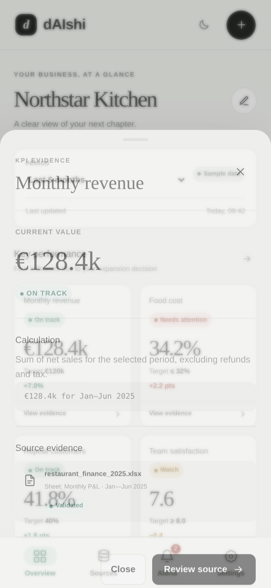

# dAIshi Design System

## Design reference and phone adaptation

> **VISUAL EXAMPLE — HOW THE APP SHOULD LOOK**
>
> **Build a Website.zip is an example of the intended look and feel of the dAIshi app.** Use it as design inspiration for colors, typography, cards, charts, and overall visual style. The phone previews below are examples of how that style can be adapted for mobile.
>
> **This is a visual reference, not a finished app or a complete functional specification.** The final app should follow the phone-only requirements in `product.md` and `architecture.md`. The example's desktop layout, sample values, and placeholder controls do not define required behavior.

The supplied Figma export, **Build a Website.zip**, is the visual reference for dAIshi. Its warm neutral colors, serif headings, restrained charts, status pills, and evidence-first dashboard inform the phone design.

- [Download the original Build a Website.zip](assets/design/Build%20a%20Website.zip)
- [Phone dashboard preview](assets/design/daishi-phone.png)
- [Phone evidence sheet preview](assets/design/daishi-phone-evidence.png)
- [Dark theme preview](assets/design/daishi-phone-dark.png)

The ZIP is preserved unchanged as reference material. It contains React and CSS source plus Figma export tooling; it is not a rendered image or a complete implementation of the product requirements. Instructions bundled in the export are reference content rather than project setup requirements.

The target product is **phone only**, as defined in [architecture.md](architecture.md). The desktop layout inside the ZIP supplies visual inspiration; the phone experience described below governs implementation. The primary target is 375–430 CSS pixels wide, with a 320-pixel minimum-width check. Larger screens may present a centered phone layout.

### Dashboard preview

### Evidence sheet preview

These previews show a design prototype using fictional restaurant data. Navigation, evidence panels, theme switching, and a sample setup walkthrough were checked in the browser. Uploads, dashboard generation, dashboard editing, and data management remain product implementation work. No Storybook instance is included in the supplied archive.

## Product character

dAIshi is a calm, practical operations dashboard for restaurant teams. The interface should feel trustworthy, quietly premium, and human. Balance dense business information with generous spacing, restrained color, serif display typography, and explicit status cues.

## Visual foundations

### Color

| Token | Light theme | Purpose |
| --- | --- | --- |
| Ink | `#20211f` | Primary text, dark controls, chart lines |
| Muted | `#72756f` | Supporting text and metadata |
| Canvas | `#f4f5f2` | Application background |
| Surface | `#ffffff` | Cards, panels, forms |
| Line | `#e2e4de` | Borders and dividers |
| Green | `#31715b` | Positive status and accents |
| Soft green | `#e9f3ee` | Positive status backgrounds |
| Red | `#a4493e` | High-severity and negative status |
| Soft red | `#f8ece9` | High-severity backgrounds |
| Amber | `#9a6c24` | Warnings, targets, watch status |
| Soft amber | `#f8f0df` | Warning backgrounds |

Dark mode uses a deep olive-black canvas, dark surfaces, softened light text, and brighter semantic accents. Pair status color with a text label or icon. Check contrast for final text sizes before release.

### Typography

Use a system sans-serif stack such as Inter when available, SF Pro Text, or Segoe UI for interface text; no external font download is required. Use Georgia or Times New Roman for display headings and key metric values, with medium weight and tight letter spacing.

Eyebrows and status labels are small, bold, and use increased letter spacing. Supporting text uses muted gray. Keep essential body text readable on a phone; the export's compact desktop text is not a requirement for every mobile screen.

## Phone layout

Use a single scrolling page with approximately 20 pixels of horizontal padding and 18–28 pixels between major sections. Respect top and bottom device safe areas. Reserve enough space beneath the content for fixed navigation.

The dashboard order is:

1. Compact header with dAIshi branding, theme control, and a circular new-dashboard action.
2. Dashboard name, decision context, and an edit action.
3. Context card with period, sample-data status, and last-updated information.
4. Two-column KPI grid with current values, targets, deltas, and evidence actions.
5. Full-width revenue and cost chart.
6. Prioritized warnings and a reminder that the human makes the decision.

Keep sources in the dedicated Sources destination. Avoid desktop sidebars, side-by-side chart panels, wide tables, and hover-dependent controls in the phone product.

## Navigation and controls

Use a fixed bottom bar with four labeled destinations: **Overview**, **Sources**, **Alerts**, and **Settings**. Highlight the active destination with green text and a soft-green icon background. Alerts may show a small count badge. Keep labels visible on phones.

Place a prominent plus action in the header for creating a dashboard. Give every icon-only action an accessible name. The prototype does not require an account, sign-in screen, or user profile.

Primary buttons use a dark ink background, light text, rounded corners, and semibold labels. Secondary buttons use a surface background and a thin border. Text buttons provide lower-emphasis actions. Aim for at least 44 × 44 CSS pixels for primary touch controls, including close, new-dashboard, and modal navigation actions.

All controls need a visible focus state. Green focus rings should remain distinguishable against both themes.

## KPI cards and status pills

KPI cards contain a label, status pill, large serif value, target, delta, and an explicit evidence action. The value is visually dominant, with target and comparison information secondary. Use two cards per row when labels and values fit; allow a single column for larger text or constrained widths.

Status pills are compact, rounded labels with a colored dot:

- **On track:** green text on soft green.
- **Needs attention:** red text on soft red.
- **Watch:** amber text on soft amber.
- **Sample data:** neutral gray-green.

Always distinguish sample results from local uploads. Missing or unresolved values must have a clear review state rather than appearing as valid results.

## Charts and warnings

Charts use thin grid lines, a dark revenue line, a dashed amber cost line, and a muted green target line. Place a small legend above the chart where it fits on a phone. Avoid saturated fills and decorative effects. Provide an accessible chart description and supporting values or summaries.

Warnings use a tinted icon tile, specific title, supporting comparison, and a detail action. High severity uses red; watch or medium severity uses amber. Warning details explain what changed, the period, the relevant target, the supporting source, and uncertainty. Present recommendations as possible next steps.

Human notes appear in a neutral gray-green inset panel. Use concise language: “You remain in control,” “Needs attention,” and “Fictional data only.”

## Evidence sheets and creation flow

On phones, evidence opens in a sheet from the bottom over a translucent backdrop. Use rounded top corners, a small drag-style visual handle, a visible close control, and independently scrollable content when necessary. The handle is decorative unless dragging is actually implemented.

Show the KPI or warning title, value, status, calculation, source file, fields, period, and caveats. Keep the underlying dashboard context. Close actions and Escape dismiss the sheet; keyboard focus stays inside while open and returns to the triggering control afterward. Prevent background scrolling.

The creation flow uses the same phone sheet treatment with a visible step indicator, choice cards, labeled inputs, and Back/Continue actions. Preserve confirmed selections when moving between steps. The supplied sample walkthrough is visual inspiration; the complete flow in [product.md](product.md) and [architecture.md](architecture.md) still needs implementation.

## Sources, settings, and privacy

Show source files as compact rows or cards with the original filename, format, validation status, period, and an accessible detail action. Wrap long filenames rather than allowing horizontal overflow.

Settings includes theme preferences, local workspace information, deletion controls when implemented, and prototype privacy guidance. Clearly warn users not to upload confidential company data. Do not imply production authentication, secure multi-user storage, live synchronization, or GDPR compliance.

## Interaction and accessibility

Use progressive disclosure: show the metric first, then its calculation and evidence. Keep transitions subtle, generally 150–250 milliseconds, and respect reduced-motion preferences.

Support keyboard navigation, visible focus, labeled fields, semantic buttons, accessible dialogs, and text alternatives for visualizations. Do not make essential information available only through hover. Keep long content scrollable without hiding controls behind bottom navigation or device safe areas.

## Validation of the phone adaptation

The local design prototype passed its TypeScript check and Vite production build. Browser checks found no horizontal overflow at widths of 320, 375, 390, and 430 CSS pixels; wider layout checks also passed. Navigation, KPI evidence sheets, warning details, Escape dismissal, theme switching, and the sample setup walkthrough passed without JavaScript errors.

These checks validate the current design prototype and do not establish completion of the full product workflow or production accessibility compliance.
