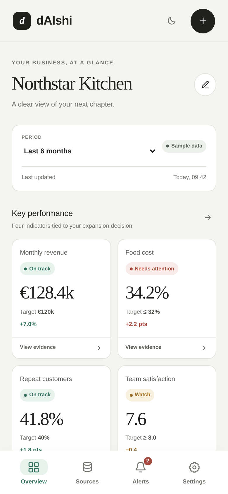
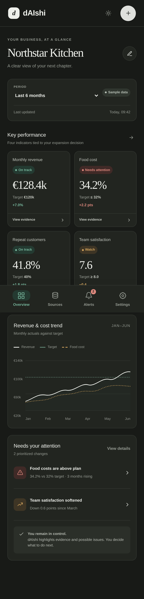

# dAIshi Design System

[Design guidance](#design-reference-and-phone-adaptation) · [Storybook](#storybook) · [Design assets](#design-assets)

## Design reference and phone adaptation

The [original design assets](#design-assets) show how the project developed. The current interface keeps the evidence-first layout and uses cobalt, cool surfaces, and stronger typography for a responsive decision workspace.

## Product character

dAIshi helps restaurant and consulting teams track business decisions and trace each result to its source. The overview prioritizes creating a dashboard and includes a real preview of the fictional restaurant data. The dashboard leads with the decision, active periods, KPIs, and warnings.
## Visual foundations

### Color

| Token | Light theme | Purpose |
| --- | --- | --- |
| Ink | `#19263b` | Primary text |
| Muted | `#526179` | Supporting text and metadata |
| Canvas | `#f3f5f9` | Application background |
| Surface | `#ffffff` | Cards, panels, forms |
| Line | `#d8dfea` | Borders and dividers |
| Cobalt | `#264cba` | Primary actions, focus, active filters, chart series |
| Green | `#236950` | Positive status |
| Soft green | `#e6f3ee` | Positive status backgrounds |
| Red | `#9c383b` | High-severity and negative status |
| Soft red | `#fbecee` | High-severity backgrounds |
| Amber | `#805112` | Warnings, targets, watch status |
| Soft amber | `#faf0dc` | Warning backgrounds |

Dark mode uses a navy canvas, light text, and a lighter cobalt accent. Pair status color with a text label or icon. Check contrast for final text sizes before release.

### Typography

Use Avenir Next when available, followed by Segoe UI and system sans-serif. Display headings use heavier weights and tighter letter spacing. KPI values use tabular numerals.

## Responsive layout

The dashboard groups the decision and time periods above the KPI cards. On phones, use one or two card columns and stack the chart above warnings. At tablet widths, use up to four KPI columns. At desktop widths, place the chart and warnings side by side. Keep the same information order and accessible controls at every width.

**Dates and filters** opens a sheet for period presets, custom comparison dates, and searchable choices from source fields. Active selections appear as removable chips. Persistent navigation sits at the bottom of small screens and moves into the header at wider widths.

## Navigation and controls

Use a fixed bottom bar with four labeled destinations: **Overview**, **Sources**, **Alerts**, and **Settings**. Highlight the active destination in cobalt. On larger screens, show the same navigation in the header. Alerts may show a small count badge. Keep labels visible on phones.

Place a prominent plus action in the header for creating a dashboard. Give every icon-only action an accessible name. The prototype does not require an account, sign-in screen, or user profile.

Primary buttons use the cobalt accent and rounded corners. Secondary buttons use a surface background and a thin border. Text buttons provide lower-emphasis actions. Aim for at least 44 × 44 CSS pixels for primary touch controls, including close, new-dashboard, and modal navigation actions.

All controls need a visible focus state. Cobalt focus rings should remain distinguishable against both themes.

## KPI cards and status pills

KPI cards contain a label, status pill, large serif value, target, delta, and an explicit evidence action. The value is visually dominant, with target and comparison information secondary. Use two cards per row when labels and values fit; allow a single column for larger text or constrained widths.

Status pills are compact, rounded labels with a colored dot:

- **On track:** green text on soft green.
- **Needs attention:** red text on soft red.
- **Watch:** amber text on soft amber.
- **Sample data:** neutral gray-green.

Always distinguish sample results from local uploads. Missing or unresolved values must have a clear review state rather than appearing as valid results.

## Charts and warnings

Charts use thin grid lines, a cobalt revenue line, a dashed amber cost line, and a muted green target line. Place a small legend above the chart where it fits on a phone. Avoid saturated fills and decorative effects. Provide an accessible chart description and supporting values or summaries.

Warnings use a tinted icon tile, specific title, supporting comparison, and a detail action. High severity uses red; watch or medium severity uses amber. Warning details explain what changed, the period, the relevant target, the supporting source, and uncertainty. Present recommendations as possible next steps.

Human notes appear in a neutral gray-green inset panel. Use concise language: “You remain in control,” “Needs attention,” and “Fictional data only.”

## Evidence sheets and creation flow

On phones, evidence opens in a sheet from the bottom over a translucent backdrop. Use rounded top corners, a small drag-style visual handle, a visible close control, and independently scrollable content when necessary. The handle is decorative unless dragging is actually implemented.

Show the KPI or warning title, value, status, calculation, source file, fields, period, and caveats. Keep the underlying dashboard context. Close actions and Escape dismiss the sheet; keyboard focus stays inside while open and returns to the triggering control afterward. Prevent background scrolling.

The creation flow uses a visible step indicator, choice cards, labeled inputs, and Back/Continue actions. Preserve confirmed selections when moving between steps. See [product.md](product.md) and [architecture.md](architecture.md) for the flow.

## Sources, settings, and privacy

Show source files as compact rows or cards with the original filename, format, validation status, period, and an accessible detail action. Wrap long filenames rather than allowing horizontal overflow.

Settings includes theme preferences, local workspace information, deletion controls when implemented, and prototype privacy guidance. Clearly warn users not to upload confidential company data. Do not imply production authentication, secure multi-user storage, live synchronization, or GDPR compliance.

## Interaction and accessibility

Use progressive disclosure: show the metric first, then its calculation and evidence. Keep transitions subtle, generally 150–250 milliseconds, and respect reduced-motion preferences.

Support keyboard navigation, visible focus, labeled fields, semantic buttons, accessible dialogs, and text alternatives for visualizations. Do not make essential information available only through hover. Keep long content scrollable without hiding controls behind bottom navigation or device safe areas.

## Validation of the phone adaptation

The local design prototype passed its TypeScript check and Vite production build. Browser checks found no horizontal overflow at widths of 320, 375, 390, and 430 CSS pixels; wider layout checks also passed. Navigation, KPI evidence sheets, warning details, Escape dismissal, theme switching, and the sample setup walkthrough passed without JavaScript errors.

These checks validate the current design prototype and do not establish completion of the full product workflow or production accessibility compliance.

## Storybook

For the components in this checkout, run `npm ci` followed by `npm run storybook` and open `http://localhost:6006`. The stories render the prototype’s React components with its shared stylesheet. Switch themes with the toolbar, and resize the preview to check phone widths. Use `npm run build-storybook` to generate a static catalogue.

| Story | What to inspect |
| --- | --- |
| [Status badge](src/components/Badge.stories.tsx) | On track, Watch, Needs attention, Cannot calculate, and Sample data labels. |
| [Bottom sheet](src/components/Sheet.stories.tsx) | Open source details, dismiss with Escape or a close control, and check that focus returns to the opener. |
| [Dashboard](src/features/DashboardView.stories.tsx) | Restaurant and consulting samples, KPI evidence, chart styles, warnings, and the unavailable state when mappings need confirmation. |

## Design assets

<strong>Open design assets — source export and phone previews</strong>

This section brings together the files in [assets/design](assets/design). Expand it to browse the previews or download the original source export.

- [Download the original Build a Website.zip](assets/design/Build%20a%20Website.zip)
- [Phone dashboard preview](assets/design/daishi-phone.png)
- [Phone evidence sheet preview](assets/design/daishi-phone-evidence.png)
- [Dark theme preview](assets/design/daishi-phone-dark.png)

The ZIP is preserved unchanged as reference material. It contains React and CSS source plus Figma export tooling; it is not a rendered image or a complete implementation of the product requirements. Instructions bundled in the export are reference content rather than project setup requirements.

### Dashboard preview

### Evidence sheet preview

These original previews use fictional restaurant data. Run [Storybook](#storybook) locally to inspect the current components and sample states.

### Dark theme preview

