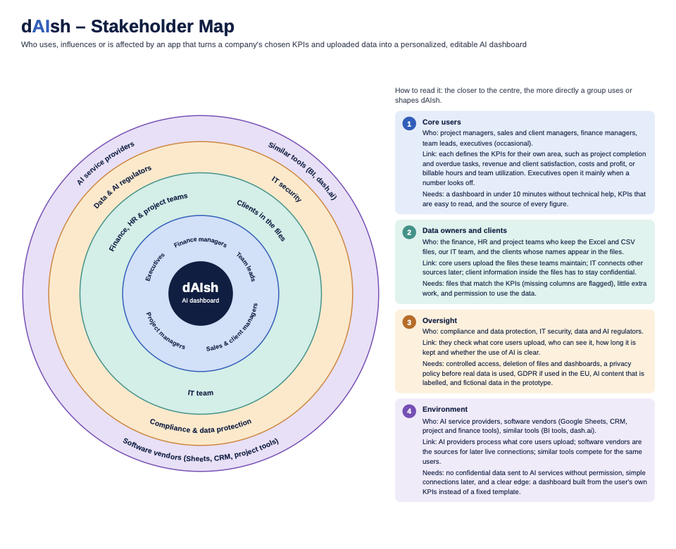

# dAIshi — Research evidence

Converted from **dAIshi Github - Workshop.docx**. The workshop’s prompts and implementation directions are source documentation, not executed instructions.

Related: [Evidence](evidence.md) · [Product](product.md) · [Architecture](architecture.md) · [Design](design.md)

## Source organization note

evidence.md — Key insights from user research: personas, user activities or situations, needs or desired outcomes, and barriers or frustrations. Use the format: “As a [persona], I want to [action] because [need], but [obstacle].”

## Research insight synthesis

These statements summarize the supplied interview notes; they are not verbatim quotations or additional research.

- As a bank investment decision-maker, I want to compare original projections with actual performance because changed assumptions affect returns, but fragmented models and irrelevant alerts make review difficult.
- As a cash equity trader, I want to track signals, assumptions, and PnL across time frames because I need to evaluate whether a signal still works, but the investment process changes constantly and accuracy is critical.
- As an investment analyst, I want to connect the investment thesis to current market and operating data because I need to explain the impact on expected returns, but manual Excel reviews must remain accurate and confidential.
- As a senior advisor supporting CEOs, I want a prioritized view across active deals because leaders need to know what matters today, but excess detail and irrelevant warnings add work.
- As the owner of a frozen fish brand, I want to compare forecasts with sales, orders, inventory, costs, and margins because I need to identify deviations early, but files and conversations are scattered and may be outdated.
- As an M&A decision-maker, I want to trace financial inconsistencies and risks to their sources because acquisition decisions depend on reliable evidence, but manual reviews can miss mismatched figures and confidential information needs protection.
- As restaurant manager Anna Philips, I want one clear view of targets, actual performance, and supporting data because I need to act quickly, but scattered information, limited review time, and unreliable alerts undermine trust.

## User Persona: Restaurant Manager

## Name

Anna Philips

## Role

Restaurant Manager in Berlin

## Background

Anna manages the daily operations of a busy restaurant. She is responsible for sales, staffing, inventory, supplier orders, costs, pricing, customer satisfaction, and business performance.

She makes operational decisions every day and also supports longer-term decisions, such as launching new menu items, increasing production, changing prices, or negotiating with suppliers.

## Goals

- Understand the restaurant’s current performance quickly.
- Compare forecasts and targets with actual results.
- Detect problems before they become expensive.
- Monitor sales, costs, inventory, staffing, and customer feedback.
- Save time when reviewing reports and business information.
- Make better decisions using reliable and understandable data.

## Current Problems

- Information is spread across spreadsheets, emails, messages, reports, and meetings.
- It can be difficult to find the latest or correct version of a file.
- Important information may be lost in conversations.
- Anna does not always have one overview of what needs attention today.
- Problems such as weak demand, excess inventory, rising costs, or falling margins may be discovered too late.
- She has limited time and cannot review every detail manually.

## Important KPIs

- Daily and weekly sales
- Revenue
- Food and operating costs
- Profit margin
- Inventory levels
- Food waste
- Supplier orders
- Staff utilization
- Customer satisfaction
- Sales by menu item
- Forecast versus actual performance
- Changes in costs or demand

## Desired App Experience

Anna wants one simple dashboard that shows:

- What is happening today
- Which KPIs have changed
- Which targets are being missed
- Which issues require immediate attention
- Why a deviation occurred
- What data supports the warning
- What action could be considered

She should be able to click on an alert and view the related sales, inventory, cost, or customer data.

## Important Alerts

The app should prioritize warnings about:

- Falling sales
- Weak demand for a menu item
- Excess inventory
- Increasing food costs
- Falling profit margins
- Unexpected changes in customer satisfaction
- Differences between forecasts and actual results
- Supplier or order issues

Alerts should be simple and prioritized. For example:

- Blue: Medium-level issue
- Red: Important issue requiring attention

## Trust Requirements

Anna would trust an alert if it:

- Uses recent and accurate data.
- Shows the data source.
- Shows the comparison period.
- Explains how the alert was calculated.
- Clearly explains what changed.
- Shows the financial or operational impact.

She would ignore alerts that are outdated, unclear, irrelevant, or based on incorrect data.

## Concerns

- Confidentiality of restaurant and financial data
- Incorrect information
- Inaccurate calculations
- AI hallucinations
- Too many irrelevant alerts
- Having to update information manually
- The app creating additional work
- A complicated interface
- Losing trust after a serious error

## Technology and Data Needs

The app should work with information from:

- Excel or CSV files
- Sales reports
- Inventory records
- Supplier orders
- Staff information
- Cost reports
- Customer feedback
- Forecasts and targets

## Persona Statement

“I need a clean and reliable overview of my restaurant so I can quickly understand what has changed, identify problems early, and decide what to do without spending hours searching through files and messages.”

## Main Feature Priority

The most valuable feature for Anna is a simple dashboard that connects restaurant targets and forecasts with actual performance, highlights important deviations, explains their causes, and shows the supporting data.
## ALL INTERVIEWS

### Interviews:

### A President of China Construction Bank

### Context

- Performs market research, financial analysis, and investment evaluation.
- Evaluates assumptions such as occupancy, rental income, operating expenses, financing costs, and exit valuations.

### Evidence-based needs

- Compare original financial projections with updated market data and actual performance.
- Monitor occupancy rates, rental income, operating costs, interest rates, and market valuations.
- Use sensitivity analysis to identify the effect of changed assumptions.
- Show how a change affects expected return on investment.
- Connect the original investment thesis with actual performance.
- Provide clear alerts when changes may materially affect returns.

### Requirements and constraints

- Integrate directly with Excel financial models.
- Use reliable data and explain what changed.
- Show the financial impact of each change.
- Avoid excessive irrelevant alerts.
- Protect confidentiality and maintain accuracy.
- Reduce work instead of creating extra tasks.
- Potential users include investment analysts, asset managers, investment managers, and senior executives.

### Cash Equity Trader at Bank of America

### Context

- Makes daily trading, investment, and business decisions.
- Worked on automating trading signals with a quant team.

### Evidence-based needs

- Record trading signals and the assumptions behind them.
- Test assumptions using real trading decisions.
- Track PnL for different signals.
- Compare current information with previous data points and related cases.
- Detect when a signal works for one time frame but not another, such as daily versus monthly.
- Reduce the time required for investment and process decisions.

### Requirements and constraints

- Warnings must account for a constantly changing investment process.
- Warnings should be supported by experience and evidence that they are correct.
- Accuracy is critical because investment decisions include subjectivity.
- The tool must shorten the process without reducing accuracy.

### Investment Analyst at Adam America

### Context

- Performs market research, financial analysis, and investment evaluation.
- Evaluates assumptions such as occupancy, rental income, operating expenses, financing costs, and exit valuations.

### Evidence-based needs

- Compare original financial projections with updated market data and actual performance.
- Monitor occupancy rates, rental income, operating costs, interest rates, and market valuations.
- Use sensitivity analysis to identify the effect of changed assumptions.
- Show how a change affects expected return on investment.
- Connect the original investment thesis with actual performance.
- Provide clear alerts when changes may materially affect returns.

### Requirements and constraints

- Integrate directly with Excel financial models.
- Use reliable data and explain what changed.
- Show the financial impact of each change.
- Avoid excessive irrelevant alerts.
- Protect confidentiality and maintain accuracy.
- Reduce work instead of creating extra tasks.
- Potential users include investment analysts, asset managers, investment managers, and senior executives.

### Senior Advisor supporting CEOs

### Context

- Supports several CEOs across multiple deals.
- Assesses opportunities, flags risks, challenges assumptions, and supports final decision-makers.

### Evidence-based needs

- Provide one control-panel view of what matters today across all active deals.
- Show, for each deal, key figures, timelines, changed assumptions, and deviations since the previous review.
- Present important information first and allow drill-down into details.
- Provide prioritized warnings about changing assumptions.
- Use simple warning levels, such as blue for medium issues and red for important issues.

### Requirements and constraints

- CEOs are the main users; advisors use the tool to support them.
- Warnings must be relevant and important enough to require attention.
- The tool must reduce workload rather than add work.
- It must protect confidentiality and provide accurate results.
- It must be clean, simple, fast, and require little training.

### Cero Gradors founder & Owner (Frozen fish Brand)

### Context

- Makes decisions about production, product launches, supermarket orders, pricing, and costs.
- Stores information across Excel files, emails, WhatsApp conversations, and meeting notes.

### Evidence-based needs

- Compare forecasts or goals with actual sales, supermarket orders, inventory, production costs, and margins.
- Track daily or weekly sell-out data.
- Track inventory by supermarket and confirmed orders.
- Identify weak demand, excess inventory, rising costs, and falling margins.
- Show the cause of deviations.
- Suggest possible solutions.

### Requirements and constraints

- Handle documents spread across folders and conversations.
- Help identify the latest version when several versions of an Excel file exist.
- Show the data source, comparison period, and calculation behind each alert.
- Do not rely on outdated data.
- Address confidentiality, incorrect data, AI hallucinations, and manual update effort.
- Be simple, easy to learn, reliable, and accurate.
- A serious failure could cause the user to stop trusting the tool.

### Business Decision-Making, Mergers & Acquisitions, and Information Management

### Context

- Makes strategic and major business decisions and oversees company operations.
- Works with mergers, acquisitions, company integration, investment attractiveness, and potential synergies.

### Evidence-based needs

- Monitor acquisition-related financial information, including ROI, EBITDA, and other performance indicators.
- Detect risks that may be missed during manual reviews.
- Recognize patterns in historical data.
- Detect inconsistencies between documents.
- Identify mismatched financial figures.
- Flag overlooked risks.
- Support the finance department with financial information and analysis.

### Requirements and constraints

- Show the source of the information used for each KPI or warning.
- Support human judgment, relationships, meetings, and communication rather than replacing them.
- Protect confidential acquisition-related information.
- Provide reliable results.

## Cross-interview product requirements

### Core workflow

- Capture the original assumptions behind a decision.
- Store the assumptions with their source documents and relevant time period.
- Connect assumptions to updated operational, financial, market, or trading data.
- Compare projected and actual values.
- Detect deviations, inconsistencies, and changed assumptions.
- Explain the potential financial or operational impact.
- Prioritize warnings by importance.
- Let users drill down into the supporting data and source documents.
- Allow teams to review, communicate, and follow up on risks.

### Common data requirements

- Original assumptions and decision rationales
- Forecasts and targets
- Actual performance data
- Financial indicators
- Market and industry data
- Operational data
- Time periods and comparison periods
- Source documents and source references
- Historical versions of files or assumptions
- Alert calculations and evidence

### Common alert requirements

- Explain what changed.
- Show the comparison period.
- Show the data source.
- Show the calculation behind the alert.
- Indicate the financial or operational impact.
- Prioritize important warnings.
- Avoid irrelevant or outdated alerts.
- Allow users to verify warnings against alternative data or related cases.

### Common trust and adoption requirements

- Accurate input data
- Reliable calculations
- Clear evidence behind warnings
- Transparency about sources and changes
- Confidentiality and data security
- Protection against AI hallucinations and model bias
- Integration with existing tools, especially Excel
- Minimal manual data entry
- A simple, fast, intuitive interface
- Low learning curve
- No additional workload for users

## MVP evidence priorities

The interviews most strongly support an MVP that demonstrates:

- A dashboard showing multiple decisions or deals in one overview.
- Assumption cards with original value, current value, deviation, and time period.
- Forecast-versus-actual comparisons.
- KPI monitoring for financial, operational, market, and trading data.
- Prioritized alerts with clear explanations and source references.
- Drill-down from an alert to the supporting data or document.
- Impact explanation, especially expected return or financial effect.
- Excel and CSV upload or integration for prototype data.
- Historical comparison and related-case comparison.
- A clean, fast interface using fictional or anonymized data.

## Evidence-based non-goals for the MVP

The interviews do not support replacing human investment judgment, relationships, meetings, or final decision-making. The tool should support review and risk detection while leaving decisions with the responsible people.

## Stakeholder map

The workshop includes this diagram of the people and organizations that use, influence, or are affected by the dashboard.

| Group | Stakeholders | Relationship and needs |
| --- | --- | --- |
| Core users | Project managers, sales and client managers, finance managers, team leads, and occasional executives | Define KPIs for their area, upload data, and review results. Need a dashboard in under ten minutes without technical help, readable KPIs, and the source of every figure. |
| Data owners and clients | Finance, HR and project teams, the IT team, and clients named in files | Maintain Excel and CSV sources; IT connects other sources later. Need matching fields, missing-column warnings, little additional work, permission to use data, and confidentiality. |
| Oversight | Compliance and data protection, IT security, and data and AI regulators | Review uploads, access, retention, and transparency about AI. Need controlled access, deletion, a privacy policy before real data use, GDPR where applicable, labeled AI content, and fictional prototype data. |
| Environment | AI service providers, software vendors such as Google Sheets and CRM/project/finance tools, and similar BI/dashboard tools | Supply processing or future connections, or compete for the same users. Need permission before sending confidential information, simple future integrations, and differentiation through user-defined KPIs. |
